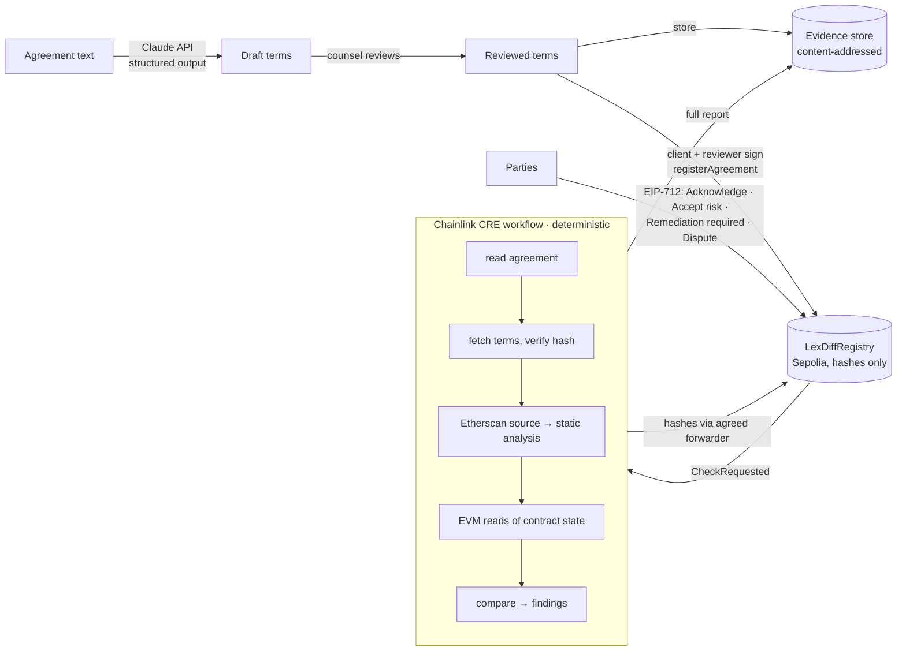

# LexDiff — responsible smart contracts

LexDiff compares a legal agreement with the smart contract that is supposed to enforce it, anchors every mismatch on-chain, and tracks who is responsible for each one until a Chainlink CRE check verifies it is resolved.

> LexDiff doesn't decide liability. It preserves the evidence a court needs to decide it.

| | |
|---|---|
| ✅ **Match** | code and agreement agree |
| ⚠️ **Mismatch** | both define it, but differently |
| ❌ **Missing** | in the agreement, not in the code |
| 🚩 **Hidden power** | in the code, not in the agreement |

## The responsibility framework: six questions

Each question has a signed or independently verified answer.

| Question | Mechanism | Who |
|---|---|---|
| 1. **What was agreed?** | Claude drafts the terms with a verbatim quote per term. The reviewer and the client sign the reviewed terms hash, the roles and the verifier (EIP-712). | Reviewer + client |
| 2. **Does the code match?** | A Chainlink CRE workflow compares the terms with the Etherscan-verified source and on-chain state, deterministically. | CRE |
| 3. **Who knew?** | Findings are anchored on-chain by hash. Parties sign *Acknowledge* on the exact evidence they saw. | Any party |
| 4. **Who took the risk, and who fixes?** | The client signs *Accepted risk*. The reviewer signs *Remediation required*, which assigns the developer. | Client / reviewer |
| 5. **Is it fixed?** | Only a report from the agreement's own verifier can mark a finding *Resolved*. No signature can. | CRE |
| 6. **Who disputes?** | Any party signs *Dispute* with a reason. The finding and its history stay unchanged. Amendments become new agreements that link to the old one. | Any party |

In RACI terms: the developer is *Responsible* for fixes, the client is *Accountable* for accepted risks, the reviewer is *Consulted* on the terms, and every party is *Informed* via the chain. The difference is that every role here is signed and verifiable.

## Legal framing

- **Evidence, not judgment.** Swedish courts apply free evaluation of evidence (*fri bevisprövning*, RB 35:1), so LexDiff's value is as credible evidence. It does not need to be legally binding.
- **Signatures prove key control, not identity.** Under eIDAS an EIP-712 signature is at most a *simple electronic signature*. It cannot be refused as evidence solely for being electronic (art. 25), but without identity binding it carries limited weight.
- **Signatures are bound to evidence.** Every decision signs the finding's current `evidenceHash`. If the finding changes before submission, the signature is rejected. Nobody can later claim they accepted something they never saw.
- **Only hashes on-chain.** Terms (party names, wallets), CRE report documents (which describe vulnerabilities) and decision notes live in a content-addressed evidence store. The chain holds only their `keccak256` hashes. This avoids publishing vulnerabilities and personal data on an immutable ledger (GDPR erasure), while keeping everything verifiable.
- **Human oversight of AI.** The extraction is a draft. The reviewer's signature over the terms hash records who approved it.
- **History is append-only.** Nothing is overwritten: an amendment is a new agreement, a regression reopens a finding, and a dispute is added alongside.

**Say:** "LexDiff compares approved agreement terms with deployed code and on-chain values, records evidence-bound signed decisions, and only marks findings resolved through reports delivered by the agreement's Chainlink CRE verifier."

**Don't say:** "LexDiff proves a developer is liable", "a wallet signature is legally binding consent", "AI verified the contract", or "the escrow is secure".

*This is the project's reading of the law, not legal advice.*

## Governance: no admin

The registry has no owner and no global settings. Each agreement names its own **verifier** (CRE forwarder, plus an optional pinned workflow owner and workflow ID) inside the registration that the client and reviewer sign. Nobody can change it afterwards, including the deployer.

A redeployed contract is **proposed** by the developer or reviewer and **accepted** by the client, who holds the funds. This prevents findings from being "resolved" against a contract nobody uses.

## Architecture



| Path | What it is |
|---|---|
| [contracts/src/LexDiffRegistry.sol](contracts/src/LexDiffRegistry.sol) | Evidence ledger: agreements, CRE checks, findings, signed decisions. Implements the CRE `IReceiver`. |
| [contracts/src/demo/](contracts/src/demo/) | `FreelanceEscrowV1` (flawed, "AI-generated"), `FreelanceEscrowV2` (remediated), `MockUSDC`. |
| [cre/lexdiff-workflow/](cre/lexdiff-workflow/) | The CRE workflow (TypeScript SDK). `compare.ts`, `source-analysis.ts` and `report.ts` are pure and unit-tested. |
| [web/](web/) | Next.js app: Claude extraction, signing, evidence store (`/api/evidence`), findings dashboard. |
| [agreements/](agreements/) | The demo agreement and an example of reviewed terms. |

### What the workflow checks (escrow, v1)

| Term | How it's checked |
|---|---|
| Client, freelancer, token, amount | A getter found by name and type in the verified ABI, read at the last finalized block |
| Delivery deadline, review period | Same, compared in seconds (`days × 86400`) |
| Refund if deadline is missed | A state-changing function named like `refund` / `reclaim` / `cancel` in the verified ABI |
| Admin powers | Static analysis of the verified source: external, state-changing functions gated by `onlyOwner`-style modifiers or `msg.sender == owner` checks, grouped by effect (`withdraw-funds`, `pause`, `upgrade`, `modify-terms`, `destroy`). Anything the agreement does not grant is a 🚩 hidden power. |

## The demo

**Agreement** ([agreements/freelance-escrow.md](agreements/freelance-escrow.md)): the client deposits 1,000 USDC. The freelancer delivers within 30 days, and the client has 7 days to review. If the deadline is missed, the client is refunded. No one may withdraw the escrowed funds.

**FreelanceEscrowV1** produces:

- ⚠️ Delivery deadline: expected 30 days, actual 3 days
- ❌ Refund if deadline is missed: no refund function
- 🚩 Admin power `withdraw-funds`: `emergencyWithdraw()` guarded by `onlyOwner`
- ✅ client, freelancer, token, amount, review period

**Then:**

1. The reviewer signs **Remediation required** on the deadline and the refund. The developer signs **Acknowledge**.
2. The client signs **Accepted risk** on the owner's withdrawal power. That is now on-chain proof the client saw that exact evidence.
3. The developer deploys **FreelanceEscrowV2** and proposes it; the client accepts it.
4. CRE re-runs. The deadline and refund move to **Resolved (verified in check #2)**. The withdrawal power stays **Accepted risk**.
5. Optionally, a party signs **Dispute** on any finding. It is shown as ⚖️ Disputed, and nothing is rewritten.

## Running it

Prerequisites: [Foundry](https://getfoundry.sh), Node 22+, [Bun](https://bun.sh), the [CRE CLI](https://docs.chain.link/cre/getting-started/cli-installation) (`cre login`), a Sepolia-funded key, an Etherscan API key, and an Anthropic API key.

### 1. Deploy contracts (Sepolia)

```bash
cd contracts
cp .env.example .env   # PRIVATE_KEY, SEPOLIA_RPC_URL, ETHERSCAN_API_KEY
source .env
forge test
forge script script/Deploy.s.sol --rpc-url sepolia --broadcast --verify
cat deployments/11155111.json
```

Escrows must be **verified on Etherscan** (`--verify` does this), because the workflow reads their source.

### 2. Web app

```bash
cd web
cp .env.example .env.local   # ANTHROPIC_API_KEY, NEXT_PUBLIC_REGISTRY_ADDRESS
npm install
npm run dev                  # http://localhost:3000
```

Open **New agreement**:

1. *Load demo agreement* → *Extract terms with Claude* → review.
2. Fill the roles. *Use my wallet* fills every role with the connected wallet, for a single-person demo. Set the contract to `escrowV1`. The verifier defaults to the Sepolia MockKeystoneForwarder.
3. *Publish terms* → *Sign as reviewer* → *Sign as client* → *Register*.

No Anthropic key? Paste [agreements/freelance-escrow.terms.example.json](agreements/freelance-escrow.terms.example.json) into the terms box instead.

### 3. CRE workflow

```bash
cd cre
cp .env.example .env         # CRE_ETH_PRIVATE_KEY, SEPOLIA_RPC_URL, ETHERSCAN_API_KEY_VALUE
cd lexdiff-workflow
bun install && bun run setup   # setup installs the Javy WASM toolchain used by `cre`
# set registryAddress (and evidenceStoreUrl if not localhost:3000) in config.staging.json
npm test                     # comparison unit tests against the real V1/V2 sources
cd ..
cre workflow simulate lexdiff-workflow --target staging-settings --broadcast \
  --non-interactive --trigger-index 0 --http-payload '{"agreementId":1}'
```

Keep the web app running: CRE fetches the terms from it and posts the report document to its evidence store.

Trigger index `0` is the HTTP trigger; `1` is the EVM log trigger on `CheckRequested` (use `--evm-tx-hash <tx> --evm-event-index <n>`).

### 4. Finish the demo

1. Refresh the agreement page: findings appear with status **Open**, details verified against their on-chain hashes.
2. As reviewer: *Require remediation* on the deadline and refund. As developer: *Acknowledge*.
3. As client: *Accept risk* on the hidden power.
4. As developer: *Propose redeployed contract* → `escrowV2`. As client: *Accept*.
5. Run the simulate command again. The deadline and refund show **Resolved**.

## Tests

```bash
cd contracts && forge test                       # 17 tests: signatures, roles, verifier pinning, snapshots, disputes, amendments
cd cre/lexdiff-workflow && npm test              # 10 tests: comparison, source analysis, report hashing on the real demo contracts
cd cre/lexdiff-workflow && bun x cre-compile main.ts /tmp/lexdiff.wasm   # WASM build check
```

## What it proves, and what it doesn't

**Proves:** which version of the agreement (terms hash, signed by client and reviewer) and the code (source hash, contract address) were compared, when, and with what result; who acknowledged, accepted, assigned or disputed each finding, with signatures bound to the evidence they saw; whether a fix was verified by the agreement's agreed verifier.

**Does not prove:** that the agreement itself is legally valid, that the AI extraction caught every term, or who the person behind a wallet is. LexDiff is a tool for evidence, not legal advice.

## Scope and limits

- Sepolia testnet only. No real funds.
- **The simulation forwarder is a mock.** `cre workflow simulate` delivers reports through the MockKeystoneForwarder, which does not verify DON signatures. In the demo, anyone could call it with a fabricated report for an agreement that uses it. Production agreements should name the KeystoneForwarder and pin the workflow owner and ID; the registry already enforces both.
- One contract type (escrow). Getter discovery is name-based; a term hidden behind an unconventional name shows up as ❌ Missing, which is the safe failure.
- The refund check is structural: it finds the function, it doesn't execute it.
- Source analysis covers the contract's own file. Privileged functions inherited from other files are not analysed yet.
- Payout conditions are extracted and shown for human review, but not yet checked automatically.
- The evidence store is the web app's local disk. Its integrity comes from the on-chain hashes; its availability does not. For hosting, swap it for persistent storage or IPFS.

## Future work

- Behavioral refund check (simulate `refund()` after the deadline with state overrides).
- Continuous monitoring: re-check upgradeable contracts on a cron trigger and alert if the code changes after signing.
- Evidence export (`evidence.json`) with transaction links per event.
- More contract types (vesting, leases, tokenized assets).
- Multi-party sign-off across organizations (the registry already accepts ERC-1271 smart-account signatures).

## Tech stack

Chainlink CRE (TypeScript SDK 1.23 + CLI) · Solidity 0.8.26 / Foundry / OpenZeppelin 5 · Sepolia · Etherscan API V2 · Claude API (`claude-opus-5-5`, structured outputs) · viem · Next.js 16
