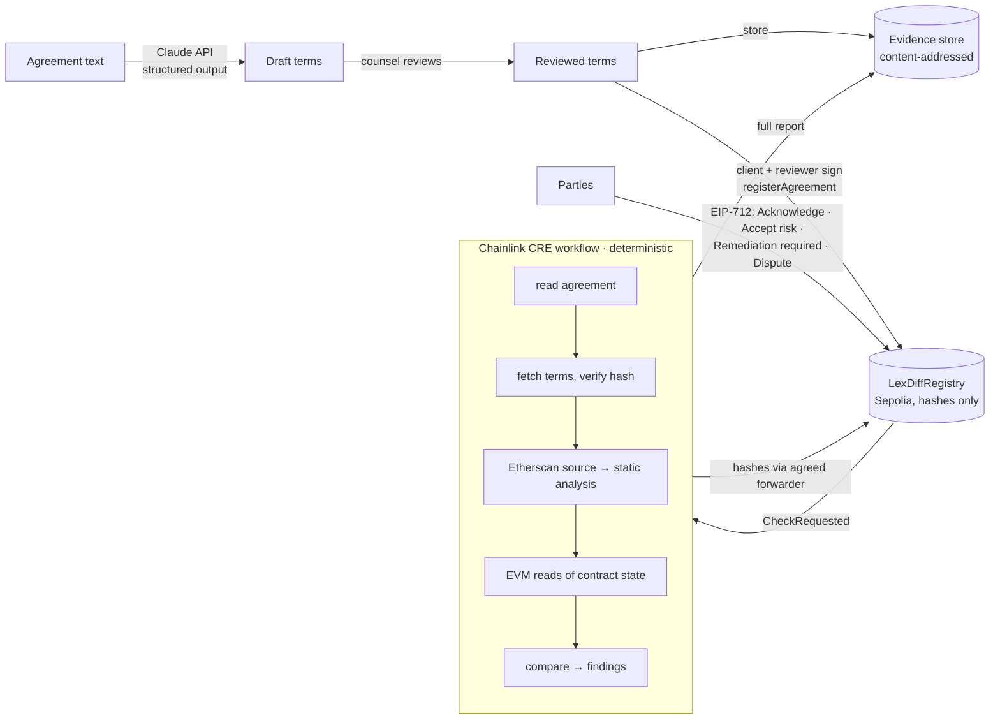

# LexDiff — verifiable agreement-to-code accountability

LexDiff compares a legal agreement with the smart contract that is supposed to enforce it, anchors every result on-chain, and tracks who decided what about each failing property until a Chainlink CRE check verifies that the same property now passes.

> We show what was checked, what was not checked, what failed, who decided what, and whether a specific failure was demonstrably corrected.

> LexDiff doesn't decide liability. It preserves the evidence a court needs to decide it.

| | |
|---|---|
| ✅ **Match** | code and agreement agree |
| ⚠️ **Mismatch** | both define it, but differently |
| ❌ **Missing** | in the agreement, not in the code |
| 🚩 **Hidden power** | in the code, not in the agreement |

## The responsibility framework: six questions

Each question has a signed or independently verified answer.

| Question | Mechanism | Who |
|---|---|---|
| 1. **What was agreed?** | Claude drafts the terms with a verbatim quote per term. The reviewer and the client sign the reviewed terms hash, the roles and the verifier (EIP-712). | Reviewer + client |
| 2. **Does the code match?** | A Chainlink CRE workflow compares the terms with the Etherscan-verified source and on-chain state, deterministically. | CRE |
| 3. **Who knew?** | Findings are anchored on-chain by hash. Parties sign *Acknowledge* on the exact evidence they saw. | Any party |
| 4. **Who took the risk, and who fixes?** | The client signs *Accepted risk*. The reviewer signs *Remediation required*, which assigns the developer. | Client / reviewer |
| 5. **Is it fixed?** | A fix is *verified* only when the same property explicitly passes a later check from the agreement's own verifier. No signature can do it, and a property missing from a report becomes *Not checked*, never fixed. | CRE |
| 6. **Who disputes?** | Any party signs *Dispute* with a reason. The finding and its history stay unchanged. Amendments become new agreements that link to the old one. | Any party |

In RACI terms: the developer is *Responsible* for fixes, the client is *Accountable* for accepted risks, the reviewer is *Consulted* on the terms, and every party is *Informed* via the chain. The difference is that every role here is signed and verifiable.

## Legal framing

- **Evidence, not judgment.** Swedish courts apply free evaluation of evidence (*fri bevisprövning*, RB 35:1), so LexDiff's value is as credible evidence. It does not need to be legally binding.
- **Signatures prove key control, not identity.** Under eIDAS an EIP-712 signature is at most a *simple electronic signature*. It cannot be refused as evidence solely for being electronic (art. 25), but without identity binding it carries limited weight.
- **Signatures are bound to evidence.** Every decision signs the finding's current `evidenceHash`. If the finding changes before submission, the signature is rejected. Nobody can later claim they accepted something they never saw.
- **Only hashes on-chain.** Terms (party names, wallets), CRE report documents (which describe vulnerabilities) and decision notes live in a content-addressed evidence store. The chain holds only their `keccak256` hashes. This avoids publishing vulnerabilities and personal data on an immutable ledger (GDPR erasure), while keeping everything verifiable.
- **Confidential to the parties.** The full agreement text and decision notes are released only to the agreement's client, lawyer, developer and payee. A party proves its wallet with a signed read pass (EIP-712 `Access`, no transaction, valid 24 hours); the store checks it against the parties recorded in the registry. Terms and Chainlink reports stay public so anyone can re-check them.
- **Honest verification levels.** 🔢 results are read from the live contract on Sepolia. 📄 results are structural: the verified source has the right shape, but nothing was executed. A fix verified only structurally is flagged as such in the app.
- **Human oversight of AI.** The extraction is a draft. The reviewer's signature over the terms hash records who approved it.
- **History is append-only.** Nothing is overwritten: an amendment is a new agreement, a regression reopens a finding, and a dispute is added alongside.

**Say:** "LexDiff compares approved agreement terms with deployed code and on-chain values, records evidence-bound signed decisions, and only marks a fix verified when the agreement's Chainlink CRE verifier reports that the same property now passes."

**Don't say:** "LexDiff proves a developer is liable", "a wallet signature is legally binding consent", "AI verified the contract", or "the escrow is secure".

*This is the project's reading of the law, not legal advice.*

## Governance: no admin

The registry has no owner and no global settings. Each agreement names its own **verifier** (CRE forwarder, plus an optional pinned workflow owner and workflow ID) inside the registration that the client and reviewer sign. Nobody can change it afterwards, including the deployer.

The parties sign the agreement **before the code exists**. The developer then deploys the escrow contract and **proposes** it; the client, who will fund it, **approves** it, and that starts the first check. A corrected contract goes through the same propose → approve path. (If the contract already exists, it can be named in the registration and is checked straight away.) Approval chooses the contract; it does not move money. Each CRE report reads the token balance of the approved contract and of the previous one, so the record shows where the funds actually are.

## Status model: four independent dimensions

A finding never collapses into one "status". Each property carries:

| Dimension | Values | Changed by |
|---|---|---|
| **Kind**: what was observed | Match · Mismatch · Missing · Hidden power | CRE report |
| **Verification**: technical result of the latest check | Pass · Fail · Inconclusive · Not checked | CRE report only |
| **Remediation**: the repair process | — · Fix required · Fix proposed · **Fix verified** · Fix reopened | Reviewer (required), developer (proposed), CRE (verified/reopened) |
| **Disposition**: the parties' risk decision | Undecided · Risk accepted · Risk not accepted · Disputed | Client (accept), reviewer (not accepted), any party (dispute) |

Rules enforced by the registry:

- **Fix verified** requires an explicit *Pass* of the same property after it failed, while a fix was in progress. A removed hidden power is reported as an explicit Pass by the workflow.
- A property **absent** from a report becomes *Not checked*; it is never treated as fixed.
- **Accepting a risk** changes the disposition only. The property still shows *Fail*.
- A proposed fix that still fails goes back to *Fix required*; a verified fix that fails again is *Fix reopened*.

## Architecture



| Path | What it is |
|---|---|
| [contracts/src/LexDiffRegistry.sol](contracts/src/LexDiffRegistry.sol) | Evidence ledger: agreements, CRE checks, findings, signed decisions. Implements the CRE `IReceiver`. Report and decision logic live in [LexDiffLogic.sol](contracts/src/LexDiffLogic.sol); shared types in [ILexDiff.sol](contracts/src/ILexDiff.sol). |
| [contracts/src/demo/](contracts/src/demo/) | `FreelanceEscrowV1` (flawed, "AI-generated"), `FreelanceEscrowV2` (remediated), `MockUSDC`. |
| [cre/lexdiff-workflow/](cre/lexdiff-workflow/) | The CRE workflow (TypeScript SDK). `compare.ts`, `source-analysis.ts` and `report.ts` are pure and unit-tested. |
| [web/](web/) | Next.js app: Claude extraction, signing, evidence store (`/api/evidence`), findings dashboard. |
| [agreements/](agreements/) | The demo agreement and an example of reviewed terms. |

### What the workflow checks (escrow, v1)

| Term | How it's checked |
|---|---|
| Client, freelancer, token, amount | A getter found by name and type in the verified ABI, read at the last finalized block |
| Delivery deadline, review period | Same, compared in seconds (`days × 86400`) |
| Refund if deadline is missed | A refund-like function in the verified source that checks the deadline (`block.timestamp`) and transfers to the client. Structural: read, not executed. |
| Admin powers | Static analysis of the verified source: external, state-changing functions gated by `onlyOwner`-style modifiers or `msg.sender == owner` checks, grouped by effect (`withdraw-funds`, `pause`, `upgrade`, `modify-terms`, `destroy`). Anything the agreement does not grant is a 🚩 hidden power. |

### Verification levels and coverage

Every finding states **how** it was established:

- 🔢 **Value**: read from the deployed contract on Sepolia (amount, deadlines, parties, token).
- 📄 **Structural**: derived from the Etherscan-verified source code (refund logic, admin powers). The code is read, not executed.

Each report also lists the terms that were **not** checked automatically (today: payout conditions), so nothing unchecked ever looks like a ✅ Match.

### Independent verification

**Export case record** on an agreement page downloads a self-contained JSON: the on-chain state, every transaction, and the off-chain documents (terms, reports, notes). The **Verify a record** page (`/verify`) re-checks it entirely in the browser against the file and a public Sepolia node, never LexDiff's own server. Each assertion comes back as **Integrity valid**, **Integrity invalid** or **Unable to verify**; tampering with any document or status is detected. It checks integrity only, never legal validity.

### A second agreement

[agreements/website-redesign.md](agreements/website-redesign.md) + [WebsiteEscrow.sol](contracts/src/demo/WebsiteEscrow.sol) show that nothing is hard-coded: different amounts and deadlines, a review period that is wrong (2 days vs 5), a pause power the agreement **grants** (✅ Match), and a deadline setter it does not (🚩 Hidden power). On `/new`, use **Second demo: website redesign**.

## The demo

**Agreement** ([agreements/freelance-escrow.md](agreements/freelance-escrow.md)): the client deposits 1,000 USDC. The freelancer delivers within 30 days, and the client has 7 days to review. If the deadline is missed, the client is refunded. No one may withdraw the escrowed funds.

The lawyer and the client sign the agreement. The developer then proposes **FreelanceEscrowV1** and the client approves it. Chainlink's first check produces:

- ⚠️ Delivery deadline: expected 30 days, actual 3 days
- ❌ Refund if deadline is missed: no refund function
- 🚩 Admin power `withdraw-funds`: `emergencyWithdraw()` guarded by `onlyOwner`
- ✅ client, freelancer, token, amount, review period

**Then:**

1. The reviewer signs **Remediation required** on the deadline and the refund. The developer signs **Acknowledge**.
2. The client signs **Accepted risk** on the owner's withdrawal power. That is now on-chain proof the client saw that exact evidence.
3. The developer deploys **FreelanceEscrowV2** and proposes it; the client accepts it.
4. CRE re-runs. The deadline and refund become **Pass · Fix verified** (in check #2). The withdrawal power stays **Fail · Risk accepted by client**: accepted, not fixed.
5. Optionally, a party signs **Dispute** on any finding. It is shown as ⚖️ Disputed, and nothing is rewritten.

## Running it

Prerequisites: [Foundry](https://getfoundry.sh), Node 22+, [Bun](https://bun.sh), the [CRE CLI](https://docs.chain.link/cre/getting-started/cli-installation) (`cre login`), a Sepolia-funded key, an Etherscan API key, and an Anthropic API key.

### 1. Deploy contracts (Sepolia)

```bash
cd contracts
cp .env.example .env   # PRIVATE_KEY, SEPOLIA_RPC_URL, ETHERSCAN_API_KEY
source .env
forge test
./script/deploy-sepolia.sh
cat deployments/11155111.json
```

Escrows must be **verified on Etherscan** (the script does this), because the workflow reads their source.

Why a shell script instead of `forge script`: Sepolia now charges far more gas per byte of deployed code than Foundry's local EVM assumes, so `forge script` estimates fail on-chain. The script uses `cast send`, which asks the Sepolia node for the real estimate. For the same reason the registry's report and decision logic lives in a separately deployed library (`LexDiffLogic`): as one contract it would exceed the 16.7M gas-per-transaction cap (EIP-7825).

### 2. Web app

```bash
cd web
cp .env.example .env.local   # ANTHROPIC_API_KEY, NEXT_PUBLIC_REGISTRY_ADDRESS
npm install
npm run dev                  # http://localhost:3000
```

Open **New agreement**:

1. *Load demo agreement* → *Extract terms with Claude* → review.
2. Fill the roles. *Use my wallet* fills every role with the connected wallet, for a single-person demo. Set the contract to `escrowV1`. The verifier defaults to the Sepolia MockKeystoneForwarder.
3. *Publish terms* → *Sign as reviewer* → *Sign as client* → *Register*.

No Anthropic key? Paste [agreements/freelance-escrow.terms.example.json](agreements/freelance-escrow.terms.example.json) into the terms box instead.

### 3. CRE workflow

```bash
cd cre
cp .env.example .env         # CRE_ETH_PRIVATE_KEY, SEPOLIA_RPC_URL, ETHERSCAN_API_KEY_VALUE
cd lexdiff-workflow
bun install && bun run setup   # setup installs the Javy WASM toolchain used by `cre`
# set registryAddress (and evidenceStoreUrl if not localhost:3000) in config.staging.json
npm test                     # comparison unit tests against the real V1/V2 sources
cd ..
cre workflow simulate lexdiff-workflow --target staging-settings --broadcast \
  --non-interactive --trigger-index 0 --http-payload '{"agreementId":1}'
```

Keep the web app running: CRE fetches the terms from it and posts the report document to its evidence store.

**Running the check from the browser (local demo):** set `ENABLE_LOCAL_CRE=true` in `web/.env.local`. The agreement page then shows a **Run the Chainlink check** button that runs the same `cre workflow simulate` command and streams its log. Never enable this on a hosted deployment.

`readFinalized` in `config.staging.json` is `false` for the demo: Sepolia finality lags about 15 minutes, so reading finalized state would miss a contract that was just registered or replaced. Production workflows should set it to `true`.

Trigger index `0` is the HTTP trigger; `1` is the EVM log trigger on `CheckRequested` (use `--evm-tx-hash <tx> --evm-event-index <n>`).

### Hosting the web app (Railway)

The app needs a persistent disk for its evidence store and signing requests.

1. Railway → **New project** → **Deploy from GitHub repo** → `LexDiff`.
2. Service **Settings → Root Directory**: `web`.
3. **Volume**: mount at `/data`.
4. **Variables**:
   - `ANTHROPIC_API_KEY`
   - `NEXT_PUBLIC_REGISTRY_ADDRESS`
   - `NEXT_PUBLIC_REGISTRY_DEPLOYMENT_BLOCK=12026189`
   - `NEXT_PUBLIC_SEPOLIA_RPC_URL`
   - `EVIDENCE_DIR=/data/evidence`
   - `REGISTRATIONS_DIR=/data/registrations`
   - `PUBLIC_BASE_URL=https://<your-domain>`
   - `ENABLE_LOCAL_CRE=false`
   - `RELAYER_PRIVATE_KEY`: a funded Sepolia key. It submits already-signed registrations and decisions, so lawyers and clients need no ETH; the signature still decides who acted.
   - `ETHERSCAN_API_KEY`: lets the contract picker show whether a contract is verified.
   - `DEMO_LAWYER_KEY`, `DEMO_CLIENT_KEY`, `DEMO_DEVELOPER_KEY`: optional; turn on presentation mode (testnet keys only).
5. **Settings → Networking → Generate domain**, put it in `PUBLIC_BASE_URL`, and redeploy.

The CRE workflow still runs from a laptop. Point it at the hosted store by setting `evidenceStoreUrl` in `cre/lexdiff-workflow/config.staging.json` to `https://<your-domain>/api/evidence`. Claude extraction is rate-limited per visitor (10 per hour).

### Presentation mode (one person plays every role)

When `DEMO_LAWYER_KEY`, `DEMO_CLIENT_KEY` and `DEMO_DEVELOPER_KEY` are set on the web service, the header shows **Presenting as ⚖️ Lawyer · 🏢 Client · 👩‍💻 Developer · 🦊 My wallet**. One click switches identity: every page then shows that party's view, and its actions are signed and sent by the server with that identity's testnet key. No MetaMask, no account switching. When it is another party's turn, the *Next* box offers **Switch to … ▸**.

The demo escrows are deployed with the demo client as client and the developer as payee, so *Fill in the demo for me* sets every role correctly. The keys can only sign LexDiff registrations and decisions for this registry, and only call this registry. **🦊 My wallet** keeps the real MetaMask flow.

### Automatic checks (the CRE worker)

Every registration, accepted contract replacement and **Request a new Chainlink check** emits `CheckRequested` on Sepolia. In production the deployed CRE workflow's log trigger answers it. This project's CRE account has no deploy access, so a worker answers it instead: it watches the registry and runs the workflow through the CRE CLI simulator (`--broadcast`) for each request. The agreement page shows *Waiting for Chainlink…* and refreshes itself when the report lands.

**In the cloud (Railway, second service):**

1. In the same Railway project: **+ New → GitHub repo → LexDiff**. **Settings → Root Directory**: `cre`. Railway builds [cre/Dockerfile](cre/Dockerfile).
2. **Volume** mounted at `/data`. It keeps the CRE login session and the last processed block.
3. **Variables**:
   - `CRE_ETH_PRIVATE_KEY`: no `0x`; pays for the report transactions.
   - `ETHERSCAN_API_KEY_VALUE`
   - `CRE_CREDENTIALS_B64`: `base64 < ~/.cre/cre.yaml` after `cre login`.
   - `CRE_CONTEXT_B64`: `base64 < ~/.cre/context.yaml`.
   - Optional: `SEPOLIA_RPC_URL`, `WATCH_FROM`.

The worker uses `cre/lexdiff-workflow/config.staging.json`, so `evidenceStoreUrl` must point at the hosted web app.

**Locally** (alternative): `cd cre/lexdiff-workflow && node watch.ts` (`--dry-run` only logs, `--from <block>` replays older requests).

### 4. Finish the demo

The agreement page shows where you are (*Agreement signed → Contract → Code checked → Decisions → Fix → Re-check → Decided*) and who has to act next. In presentation mode, switch roles in the header.

1. As developer: propose the contract you deployed (`escrowV1` is prefilled). As client: approve it. **Chainlink checks it.** Three issues appear, each in plain language ("The agreement says 30 days / The code does 3 days").
2. As reviewer: *Developer must fix this* on the deadline and refund. As developer: *I have seen this*.
3. As client: *I accept this risk* on the hidden power.
4. As developer: propose the corrected contract (`escrowV2` is prefilled). As client: approve it.
5. **Run the Chainlink check** again. The deadline and refund show **Fixed: confirmed by Chainlink**.

## Deployment and test matrix (29 October 2026)

| What | Where | Status |
|---|---|---|
| LexDiffRegistry | Sepolia [`0x1dc9…a7fd`](https://sepolia.etherscan.io/address/0x1dc9a1af1d6818ed9fc945598caaa0eef8b0a7fd#code), block 12026189 | Deployed and verified |
| LexDiffLogic (library) | Sepolia [`0xb0ed…d487`](https://sepolia.etherscan.io/address/0xb0edb5b48a52819ef7f265a2651ba8a498f7d487#code) | Deployed and verified |
| Demo escrows V1 / V2 / WebsiteEscrow, MockUSDC | Addresses in [contracts/deployments/11155111.json](contracts/deployments/11155111.json) | Deployed and verified |
| Registry tests | `forge test` | 22/22 pass |
| Workflow tests | `npm test` in `cre/lexdiff-workflow` | 15/15 pass |
| Workflow WASM build | `bun x cre-compile` | Builds |
| Full flow on a local chain | web EIP-712 + workflow encoding + registry | Pass: V1 fails → decisions → V2 → fixes verified, accepted risk still fails |
| CRE simulation against Sepolia | CRE CLI simulator, `--broadcast`, mock forwarder | Ran end to end on the previous registry; container build tested on Linux |
| Trust model | Sepolia **MockKeystoneForwarder** | Does not verify DON signatures (simulation). Production needs the KeystoneForwarder and a deployed workflow (requires CRE deploy access). |

## Tests

```bash
cd contracts && forge test                       # 23 tests: signatures, roles, signing before the contract exists, verifier pinning, status model, disputes, amendments
cd cre/lexdiff-workflow && npm test              # 15 tests: comparison, explicit results, removed powers, levels/coverage, second agreement, report hashing
cd cre/lexdiff-workflow && bun x cre-compile main.ts /tmp/lexdiff.wasm   # WASM build check
```

## What it proves, and what it doesn't

**Proves:** which version of the agreement (terms hash, signed by client and reviewer) and the code (source hash, contract address) were compared, when, and with what result; who acknowledged, accepted, assigned or disputed each finding, with signatures bound to the evidence they saw; whether a fix was verified by the agreement's agreed verifier.

**Does not prove:** that the agreement itself is legally valid, that the AI extraction caught every term, or who the person behind a wallet is. LexDiff is a tool for evidence, not legal advice.

## Scope and limits

- Sepolia testnet only. No real funds.
- **The simulation forwarder is a mock.** `cre workflow simulate` delivers reports through the MockKeystoneForwarder, which does not verify DON signatures. In the demo, anyone could call it with a fabricated report for an agreement that uses it. Production agreements should name the KeystoneForwarder and pin the workflow owner and ID; the registry already enforces both.
- One contract type (escrow). Getter discovery is name-based; a term hidden behind an unconventional name shows up as ❌ Missing, which is the safe failure.
- The refund check is structural: it reads the function's code (deadline check, transfer to client), it doesn't execute it.
- Payout conditions are extracted and listed as "not checked automatically" for human review.
- Source analysis covers the contract's own file. Privileged functions inherited from other files are not analysed yet.
- The evidence store is the web app's local disk. Its integrity comes from the on-chain hashes; its availability does not. For hosting, swap it for persistent storage or IPFS.

## Future work

- Behavioral refund check (simulate `refund()` after the deadline with state overrides).
- Continuous monitoring: re-check upgradeable contracts on a cron trigger and alert if the code changes after signing.
- More contract types (vesting, leases, tokenized assets).
- Multi-party sign-off across organizations (the registry already accepts ERC-1271 smart-account signatures).

## Tech stack

Chainlink CRE (TypeScript SDK 1.23 + CLI) · Solidity 0.8.26 / Foundry / OpenZeppelin 5 · Sepolia · Etherscan API V2 · Claude API (`claude-opus-5-5`, structured outputs) · viem · Next.js 16
