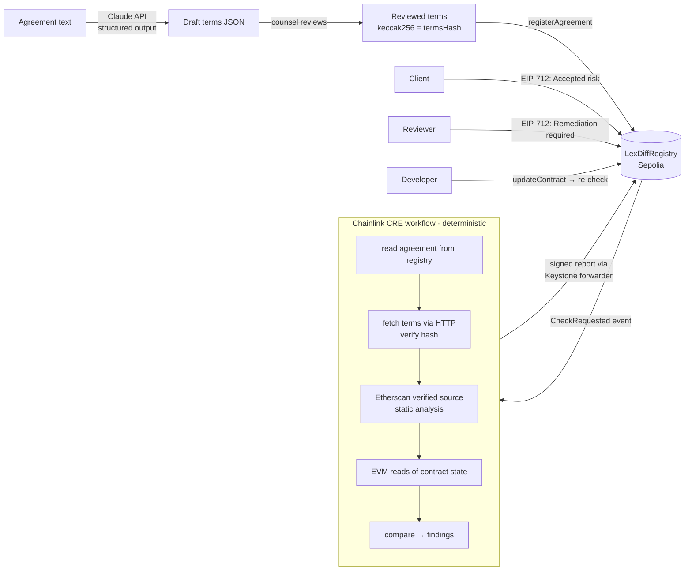

# LexDiff — responsible smart contracts

LexDiff compares a legal agreement with the smart contract that is supposed to enforce it, records every mismatch on-chain, and tracks who is responsible for each one until it is verifiably resolved.

> LexDiff doesn't decide liability. It preserves the evidence a court needs to decide it.

| | |
|---|---|
| ✅ **Match** | code and agreement agree |
| ⚠️ **Mismatch** | both define it, but differently |
| ❌ **Missing** | in the agreement, not in the code |
| 🚩 **Hidden power** | in the code, not in the agreement |

## Architecture



| Path | What it is |
|---|---|
| [contracts/src/LexDiffRegistry.sol](contracts/src/LexDiffRegistry.sol) | Evidence ledger: agreements, CRE checks, findings, signed decisions. Implements the CRE `IReceiver`. |
| [contracts/src/demo/](contracts/src/demo/) | `FreelanceEscrowV1` (flawed, "AI-generated"), `FreelanceEscrowV2` (remediated), `MockUSDC`. |
| [cre/lexdiff-workflow/](cre/lexdiff-workflow/) | The CRE workflow (TypeScript SDK). `compare.ts` and `source-analysis.ts` are pure and unit-tested. |
| [web/](web/) | Next.js app: Claude extraction, terms publishing, findings dashboard, EIP-712 signing. |
| [agreements/](agreements/) | The demo agreement and an example of reviewed terms. |

### Why the pieces sit where they do

- **AI extraction runs outside CRE.** LLM output is not deterministic enough for DON consensus. Claude produces a *draft* with a verbatim source quote for every term; a human reviews it, and only the reviewed JSON is hashed and registered.
- **CRE only runs deterministic checks.** Every node fetches the same terms (verified against the on-chain `termsHash`), the same Etherscan source and the same finalized chain state, and runs the same pure comparison. HTTP results use identical-aggregation consensus.
- **Only CRE can resolve.** No decision type in the registry sets `Resolved`. A finding moves to `Resolved` only when a later CRE report no longer contains the mismatch. If it comes back, it's reopened.
- **Signatures are bound to evidence.** An EIP-712 decision signs the finding's current `evidenceHash` (agreement, check number, contract, code hash, terms hash, expected/actual). If the finding changes before the signature is submitted, the signature is rejected. Nobody can claim the client accepted a risk they never saw.
- **Reports are snapshots.** A finding that disappears from the code (e.g. a removed admin function) is resolved by the next check.
- **The registry rejects stale reports.** A report must be for the agreement's *current* contract and the registered terms hash.

### What the workflow checks (escrow, v1)

| Term | How it's checked |
|---|---|
| Client, freelancer, token, amount | Getter found by name and type in the verified ABI, read at the last finalized block |
| Delivery deadline, review period | Same, compared in seconds (`days × 86400`) |
| Refund if deadline is missed | A state-changing function named like `refund` / `reclaim` / `cancel` in the verified ABI |
| Admin powers | Static analysis of the verified source: external, state-changing functions gated by `onlyOwner`-style modifiers or `msg.sender == owner` checks, grouped by effect (`withdraw-funds`, `pause`, `upgrade`, `modify-terms`, `destroy`). Anything the agreement does not grant is a 🚩 hidden power. |

## The demo

**Agreement** ([agreements/freelance-escrow.md](agreements/freelance-escrow.md)): the client deposits 1,000 USDC. The freelancer delivers within 30 days, and the client has 7 days to review. If the deadline is missed, the client is refunded. No one may withdraw the escrowed funds.

**FreelanceEscrowV1** produces:

- ⚠️ Delivery deadline: expected 30 days, actual 3 days
- ❌ Refund if deadline is missed: no refund function
- 🚩 Admin power `withdraw-funds`: `emergencyWithdraw()` guarded by `onlyOwner`
- ✅ client, freelancer, token, amount, review period

**Then:**

1. The reviewer signs **Remediation required** on the deadline and the refund. Both are assigned to the developer.
2. The client signs **Accepted risk** on the owner's withdrawal power. That is now on-chain proof the client was informed.
3. The developer deploys **FreelanceEscrowV2** and points the agreement to it.
4. CRE re-runs. Deadline and refund move to **Resolved (verified in check #2)**. The withdrawal power stays **Accepted risk**.

## Running it

Prerequisites: [Foundry](https://getfoundry.sh), Node 22+, [Bun](https://bun.sh), the [CRE CLI](https://docs.chain.link/cre/getting-started/cli-installation) (`cre login`), a Sepolia-funded key, an Etherscan API key, and an Anthropic API key.

### 1. Deploy contracts (Sepolia)

```bash
cd contracts
cp .env.example .env   # PRIVATE_KEY, SEPOLIA_RPC_URL, ETHERSCAN_API_KEY
source .env
forge test
forge script script/Deploy.s.sol --rpc-url sepolia --broadcast --verify
cat deployments/11155111.json
```

The registry trusts the Sepolia **MockKeystoneForwarder** `0x15fC6ae953E024d975e77382eEeC56A9101f9F88`, which `cre workflow simulate --broadcast` delivers reports through. For a deployed workflow, call `setForwarder` with the production KeystoneForwarder.

Escrows must be **verified on Etherscan** (`--verify` does this): the workflow reads their source.

### 2. Web app

```bash
cd web
cp .env.example .env.local   # ANTHROPIC_API_KEY, NEXT_PUBLIC_REGISTRY_ADDRESS
npm install
npm run dev                  # http://localhost:3000
```

Open **New agreement** → *Load demo agreement* → *Extract terms with Claude* → review → fill the roles (the *Use my wallet* button fills every role with the connected wallet, for a single-person demo) → contract = `escrowV1` → *Publish terms & register on-chain*.

No Anthropic key? Paste [agreements/freelance-escrow.terms.example.json](agreements/freelance-escrow.terms.example.json) into the terms box instead.

### 3. CRE workflow

```bash
cd cre
cp .env.example .env         # CRE_ETH_PRIVATE_KEY, SEPOLIA_RPC_URL, ETHERSCAN_API_KEY_VALUE
cd lexdiff-workflow
bun install
# set registryAddress in config.staging.json
npm test                     # comparison unit tests against the real V1/V2 sources
cd ..
cre workflow simulate lexdiff-workflow --target staging-settings --broadcast \
  --non-interactive --trigger-index 0 --http-payload '{"agreementId":1}'
```

Trigger index `0` is the HTTP trigger; `1` is the EVM log trigger on `CheckRequested` (use `--evm-tx-hash <registerAgreement or updateContract tx> --evm-event-index <n>`).

The terms URI points at the web app (`PUBLIC_BASE_URL`, default `http://localhost:3000`), which works for local simulation. For a deployed workflow, host the terms at a public URL (or IPFS) — the hash check makes the host irrelevant to integrity.

### 4. Finish the demo

1. Refresh the agreement page: findings appear with status **Open**.
2. As reviewer: open the deadline and refund findings → *Sign: Remediation required*.
3. As client: open the hidden power → *Sign: Accepted risk*.
4. As developer: *Point agreement to new contract* → `escrowV2`.
5. Run the simulate command again. Deadline and refund show **Resolved**.

## Tests

```bash
cd contracts && forge test                       # registry: roles, signatures, snapshot semantics, regressions
cd cre/lexdiff-workflow && npm test              # comparison + source analysis on the real demo contracts
cd cre/lexdiff-workflow && bun x cre-compile main.ts /tmp/lexdiff.wasm   # WASM build check
```

## What it proves, and what it doesn't

**Proves:** which version of the agreement (terms hash) and the code (source hash, contract address) were compared, when, and with what result; who accepted each risk and who was assigned each fix, with signatures bound to the evidence they saw; whether a fix was independently verified by CRE.

**Does not prove:** that the agreement itself is legally valid, or that the AI extraction caught every term. Extracted terms must be reviewed by a lawyer. LexDiff is a tool for evidence, not legal advice.

## Scope and limits

- Sepolia testnet only. No real funds.
- One contract type (escrow). Getter discovery is name-based; contracts that hide terms behind unconventional names show up as ❌ Missing, which is the safe failure.
- Source analysis covers the contract's own file. Privileged functions inherited from other files are not analysed yet.
- Payout conditions are extracted and shown for human review, but not yet checked automatically.
- CRE is demonstrated through CRE CLI simulation. The registry does not yet pin the workflow owner/ID from report metadata; do that before production.

## Future work

- Continuous monitoring: re-check upgradeable contracts on a cron trigger and alert if the code changes after signing.
- More contract types (vesting, leases, tokenized assets).
- Multi-party sign-off across organizations (the registry already accepts ERC-1271 smart-account signatures).

## Tech stack

Chainlink CRE (TypeScript SDK 1.23 + CLI) · Solidity 0.8.26 / Foundry / OpenZeppelin 5 · Sepolia · Etherscan API V2 · Claude API (`claude-opus-5-5`, structured outputs) · viem · Next.js 16
